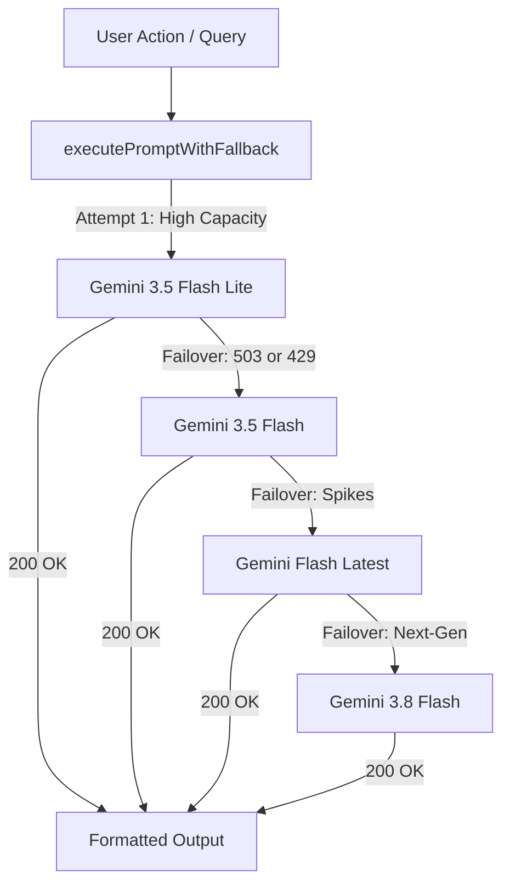

<div align="center">

# ⚡ Placement Assistant AI Platform

### Next-Gen AI-Powered Career Copilot, ATS Diagnostics & Technical Interview Simulator

[](https://placement-assistant.netlify.app)
[](https://nextjs.org/)
[](https://aistudio.google.com/)
[](https://www.typescriptlang.org/)
[](https://tailwindcss.com/)
[](LICENSE)

[**🌐 Explore Live Demo**](https://placement-assistant.netlify.app) • [**📖 Design Specs**](DESIGN.md) • [**🚀 Deployment Guide**](DEPLOYMENT.md) • [**🐛 Report Bug**](https://github.com/SAI-SON/Placement-Assistant/issues)

</div>

---

## 🌟 Overview

**Placement Assistant** is an all-in-one AI career co-pilot engineered for software engineers, new graduates, and tech job seekers. Built with **Next.js 15 (App Router)** and **Google Gemini AI**, the platform bridges the gap between candidate qualifications and recruiter expectations through instant ATS scoring, live STAR-method interview simulations, automated PDF resume generation, and real-time career coaching.

Styled with a bespoke **Obsidian & Cyberpunk Glassmorphism** design system, Placement Assistant provides a frictionless, high-performance experience with GPU-accelerated micro-animations, ISR data caching, and resilient multi-model AI failovers.

---

## 🚀 Live Demo

Experience the live application deployed on Netlify:

👉 **[https://placement-assistant.netlify.app](https://placement-assistant.netlify.app)**

---

## ✨ Key Features

### 1. 📊 Executive Candidate Dashboard
- **Placement Readiness Telemetry**: Live radial HUD telemetry scoring your overall readiness (0-100%).
- **Interactive Bento Grid**: Quick navigation to mock drills, resume builders, ATS diagnostics, and curated learning.
- **Target Company Pipeline**: Real-time tracking of applications across tech tiers (Google, Amazon, Microsoft, Startups).
- **Global Command Bar**: Press <kbd>⌘K</kbd> / <kbd>Ctrl+K</kbd> anywhere to search tools, jobs, or run drills instantly.

### 2. 📄 ATS Resume Diagnostics & Scoring
- **Automated ATS Screening**: Upload your resume (PDF/DOCX) for deep structural and keyword parsing.
- **Detailed Evaluation Matrix**: Granular breakdowns across **Impact Scoring**, **Keyword Density**, and **Clarity**.
- **"Before vs. After" Rewrite Engine**: Actionable suggestions transforming vague duties into metric-driven accomplishments.

### 3. 🤖 AI Career & Technical Coach
- **Real-Time Interactive Mentorship**: Ask questions regarding bullet points, career gaps, or recruitment strategies.
- **Technical Code Generator**: Request interview algorithms, data structures (Java, Python, TypeScript), or system designs with syntax-highlighted code blocks.
- **Rich Markdown Formatting**: Clean typography without raw asterisk glitches, featuring high-contrast keywords and interactive lists.

### 4. 🎤 AI Interview Coach Simulator
- **Adaptive Question Generation**: Role-specific technical and behavioral questions calibrated to your resume.
- **STAR Methodology Evaluation**: Instant evaluation assessing your **Situation, Task, Action, and Result**.
- **Scored Debriefing**: Delivery breakdowns with concrete advice on what you did well and where to improve.

### 5. 📝 ATS Markdown Resume Builder & PDF Export
- **Live Markdown Synchronizer**: Edit candidate details and see a live ATS-optimized resume preview side-by-side.
- **Single-Click PDF Export**: Uses `html2canvas` and `jsPDF` for instant high-resolution ATS single-column resumes.

### 6. 🗺️ Career Pathway & Video Masterclasses
- **Skill Gap Roadmaps**: Curated learning pathways across Full-Stack, Cloud & DevOps, Data Science, and Mobile.
- **Curated Video Courses**: Embedded masterclasses mapped to your specific identified weaknesses.

### 7. 📰 Tech Hiring & Local Job News
- **Hiring Radar**: Real-time regional and international tech job market pulses.
- **ISR Cached**: Cached Next.js feeds preventing rate limits and guaranteeing instantaneous load times.

---

## 🛡️ Multi-Model AI Failover Architecture

Placement Assistant uses an automated multi-model failover pool to eliminate Google AI rate limits (`429 Too Many Requests`) and server demand spikes (`503 Service Unavailable`):



---

## 🛠️ Tech Stack

| Category | Technologies |
| :--- | :--- |
| **Framework** | [Next.js 15.5](https://nextjs.org/) (App Router, Server Actions) |
| **Frontend Library** | [React 18.3](https://react.dev/) |
| **Language** | [TypeScript 5](https://www.typescriptlang.org/) |
| **Styling** | [Tailwind CSS 3.4](https://tailwindcss.com/), `@tailwindcss/typography` |
| **Design System** | Custom Glassmorphism, [Radix UI](https://www.radix-ui.com/), [Lucide Icons](https://lucide.dev/) |
| **Animations** | [Framer Motion 11](https://www.framer.com/motion/) |
| **AI Runtime** | [Google Gemini AI](https://aistudio.google.com/) via [Genkit](https://firebase.google.com/docs/genkit) |
| **Document Generation** | [jsPDF](https://github.com/parallax/jsPDF), [html2canvas](https://html2canvas.hertzen.com/) |
| **Deployment** | [Netlify](https://www.netlify.com/) / [Vercel](https://vercel.com/) |

---

## 🏁 Getting Started

### Prerequisites

- **Node.js**: `v20.x` or higher
- **Package Manager**: `npm` (or `pnpm` / `yarn`)
- **Google Gemini API Key**: [Get a free API Key from Google AI Studio](https://aistudio.google.com/app/apikey)

### Installation

1. **Clone the repository:**
   ```bash
   git clone https://github.com/SAI-SON/Placement-Assistant.git
   cd Placement-Assistant
   ```

2. **Install project dependencies:**
   ```bash
   npm install
   ```

3. **Configure Environment Variables:**
   Copy the `.env.example` template:
   ```bash
   cp .env.example .env.local
   ```

   Open `.env.local` and add your API keys:
   ```env
   # Required: Google Gemini AI
   GEMINI_API_KEY=your_google_gemini_api_key

   # Optional: Preferred model override (Defaults to gemini-3.5-flash-lite)
   GEMINI_MODEL=googleai/gemini-3.5-flash-lite

   # Optional: For Live Job News & Video Recommendations
   NEWS_API_KEY=your_news_api_key
   YOUTUBE_API_KEY=your_youtube_api_key
   ```

4. **Start the local development server:**
   ```bash
   npm run dev
   ```

5. **Open in browser:**
   Navigate to [http://localhost:9002](http://localhost:9002)

---

## 📜 Available Scripts

| Command | Purpose |
| :--- | :--- |
| `npm run dev` | Starts the Next.js development server on port `9002` |
| `npm run build` | Compiles optimized production bundle |
| `npm run start` | Runs the production build locally |
| `npm run typecheck` | Validates TypeScript types across the entire codebase |
| `npm run lint` | Runs ESLint analysis |
| `npm run lint:fix` | Automatically fixes ESLint style issues |
| `npm run optimize` | Runs typechecks and linter fixes in one command |

---

## 🌐 Deployment

### Deploying to Netlify (Current Demo Host)

1. Connect your GitHub repository to [Netlify](https://app.netlify.com/).
2. Set Build Command: `npm run build`
3. Set Publish Directory: `.next`
4. Add the **`@netlify/plugin-nextjs`** plugin for Server Actions runtime support.
5. In **Site Configuration > Environment Variables**, add:
   - `GEMINI_API_KEY` = `your_gemini_api_key`
6. Deploy!

### Deploying to Vercel

[](https://vercel.com/new/clone?repository-url=https://github.com/SAI-SON/Placement-Assistant)

1. Import your GitHub repository into Vercel.
2. Vercel automatically detects Next.js 15 and configures build settings.
3. Set `GEMINI_API_KEY` under Environment Variables.
4. Click **Deploy**.

For detailed step-by-step guides, refer to [DEPLOYMENT.md](DEPLOYMENT.md).

---

## 📁 Repository Structure

```
Placement-Assistant/
├── .env.example              # Environment variables template
├── DESIGN.md                 # Design system tokens & aesthetics documentation
├── DEPLOYMENT.md             # Production deployment instructions
├── netlify.toml              # Netlify Next.js runtime configuration
├── package.json              # Scripts and dependencies
├── src/
│   ├── ai/
│   │   ├── genkit.ts         # Genkit configuration & multi-model failover
│   │   ├── ai-feedback-chat.ts # Career Coach prompt & flow
│   │   └── flows/            # ATS scoring, interview, and resume flows
│   ├── app/
│   │   ├── layout.tsx        # Root layout, fonts, and GPU background
│   │   ├── globals.css       # Glassmorphism utilities & theme tokens
│   │   ├── page.tsx          # Executive Candidate Dashboard
│   │   ├── upload-resume/    # ATS Diagnostic & Resume Analysis
│   │   ├── ai-coach/         # Interactive AI Mentor Chat
│   │   ├── ai-interview-coach/ # 4-Stage Mock Interview Simulator
│   │   ├── resume-templates/ # Markdown Resume Builder & PDF Export
│   │   ├── career-pathway/   # Learning Roadmaps & Video Masterclasses
│   │   └── job-news/         # Regional Tech Hiring & News Feed
│   ├── components/
│   │   ├── app/              # Header, Sidebar, ScoreChart, GlassCards
│   │   └── ui/               # Radix UI primitive components
│   └── lib/
│       ├── actions.ts        # Server Actions & API error sanitizer
│       └── utils.ts          # Class merging and string utilities
```

---

## 🤝 Contributing

Contributions are always welcome!
1. Fork the Project (`https://github.com/SAI-SON/Placement-Assistant/fork`)
2. Create your Feature Branch (`git checkout -b feature/AmazingFeature`)
3. Commit your Changes (`git commit -m 'feat: Add AmazingFeature'`)
4. Push to the Branch (`git push origin feature/AmazingFeature`)
5. Open a Pull Request

---

## 📄 License

Distributed under the **MIT License**. See `LICENSE` for more information.

---

<div align="center">
Developed with ❤️ by <a href="https://github.com/SAI-SON"><strong>SAI-SON</strong></a> • Powered by <strong>Google Gemini AI</strong> & <strong>Next.js 15</strong>
</div>
